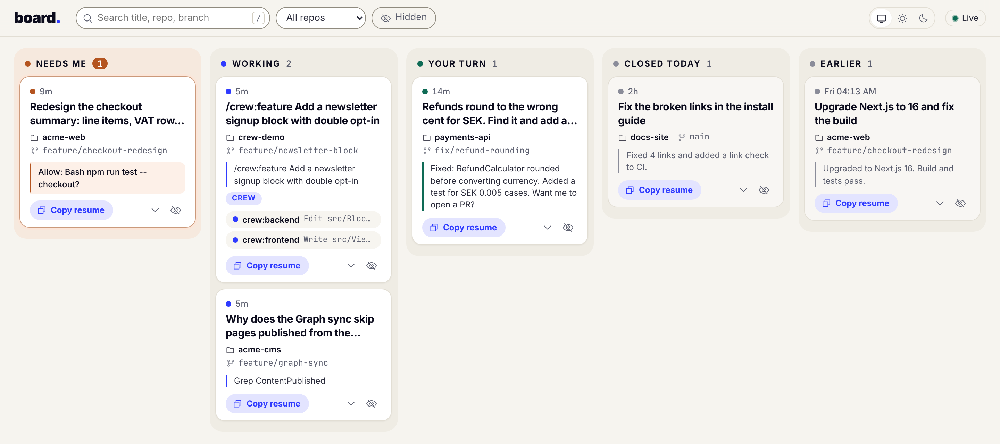

# board

[](https://github.com/johantor/board/releases)
[](https://github.com/johantor/board/actions/workflows/validate.yml)
[](LICENSE)

**Every Claude Code session on one board.** board is a
[Claude Code](https://code.claude.com/docs/en/overview) plugin: hooks log each session's state,
and a small Node server on 127.0.0.1 shows it as cards. It answers three questions: which sessions
need you now, what is running and where, and how to get back into what you worked on yesterday.

```bash
claude plugin marketplace add johantor/plugins
claude plugin install board@johantor
```

<picture>
  <source srcset="docs/board-dark.png" media="(prefers-color-scheme: dark)">
  
</picture>

Site: <https://johantor.github.io/board/>

## Why a board

- **One place to look.** Five terminals, three repos, one prompt waiting somewhere. The board
  moves that session to Needs me, and the tab title counts them.
- **Back in with one click.** **Copy resume** copies `cd '<dir>'; claude --resume <id>`, which runs
  in bash, zsh and PowerShell.
- **Nothing lost while it is down.** The hooks write a file, not to the server. History from
  before the plugin comes back from the transcripts.
- **It stays on your machine.** The server listens on 127.0.0.1 only, and session data needs a
  token from a file only you can read. See [Privacy](#privacy).

## Quick start

In any Claude Code session:

```
/board:open
```

It starts the server in the background and opens `http://127.0.0.1:7428/?t=<token>`. The token
keeps other users on the machine out. The page moves it into the browser's local storage for that
port, so a bookmark of `http://127.0.0.1:7428/` works after that.

Press `/` to search. The theme follows the browser until you pick Light or Dark; the choice is
saved in the browser.

## The columns

| Column | A card is here when |
|---|---|
| Needs me | A permission prompt, a question, or an API error waits for you. |
| Working | Claude is on a turn. A `stale?` badge marks a card silent for 10 minutes. |
| Your turn | The turn ended and Claude waits for your next prompt. |
| Closed today | The session ended today. A session silent for 12 hours counts as ended. |
| Earlier | It ended before today, within the last 7 days. Search reaches back 30 days (`--days`). |

## The card

| Part | What it does |
|---|---|
| Title | The `/rename` name, else the first prompt. |
| Repo, branch, activity | Where the session runs, the latest activity, and how long ago it happened. |
| **Copy resume** (or a click on the card) | Copies `cd '<dir>'; claude --resume <id>`. The quotes are single, so a folder name cannot run code when you paste it. A folder name with a character outside letters, digits and plain ASCII punctuation (a quote of any kind, a tab) gets no `cd`, and the board says so. |
| **More** (the chevron) | The last reply, the last tool calls, the subagents, and the session's mode and end reason. |
| **Hide** (the crossed eye) | Takes the card off the board; the **Hidden** filter shows it again. Hide only adds a line to the board's log: the session and its transcript stay as they are. |

**Subagents are not cards.** A subagent runs inside its parent session, so it shows on that
session's card: each running subagent with its current tool, plus a count of finished ones. A
subagent's permission prompt moves the parent card to Needs me. The card stays there while any
question is open, the session's own or a subagent's, and each closes only with its own answer. A
session that ended its turn while its subagents run stays in Working until the last one stops.
Sessions that run a `crew:` agent ([crew](https://github.com/johantor/crew)) get a Crew
badge.

## How it works

1. Hooks on 12 session events run `hooks/capture.sh`, which hands the payload to Node. Node
   distills it to one short line and appends it to `~/.claude/board/events.jsonl`. Ten hooks are
   async and never block a session. Two run in the foreground, for up to 5 seconds:
   `PermissionRequest`, so its line lands before the tool runs (it adds about 0.1 s before the
   prompt shows), and `SessionEnd`, so its line lands before Claude Code exits. None fails a
   session: no Node, a bad payload or a full disk all exit 0.
2. The server replays that log into cards and tails it every second. It writes to the same file
   only when you hide a card.
3. On start, and every 5 minutes, it reads the session transcripts under `~/.claude/projects`
   (only the first and last 256 KiB of each). That fills the board with sessions from before the
   plugin.

## Options

```bash
node <plugin dir>/server/board.mjs [--port 7428] [--days 30] [--detach] [--open]
```

| Setting | Default | Effect |
|---|---|---|
| `--port`, `CLAUDE_BOARD_PORT` | `7428` | The server's port. The hooks do not use it. |
| `--days` | `30` | How far back the board loads sessions. |
| `CLAUDE_BOARD_DIR` | `~/.claude/board` | Where the event log and the token live. Set it for the hooks too. |
| `CLAUDE_CONFIG_DIR` | `~/.claude` | Where the transcripts are read from. |

To reset the board, stop the server and delete `events.jsonl`. History comes back from the
transcripts.

## Privacy

Prompts and replies can hold client code and secrets, so the board stays on your machine. Nothing
is sent anywhere.

- **127.0.0.1 only.** The server refuses a request that names another host.
- **A token for session data.** Every request needs the token from `~/.claude/board/token`
  (mode 600), since 127.0.0.1 is open to every user on the machine. It goes only as a header (as
  `?t=` on the live stream), never as a cookie, which the browser would also send to other ports
  on 127.0.0.1.
- **No token to a squatter.** `/board:open` checks for a running board by having it sign a random
  value with the token, so a program squatting on the port never receives the token.
- **Same-origin writes.** Hiding a card takes a JSON request from the board's own origin.
- **Short lines.** The log is written with mode 600, and each line keeps at most the first 200
  characters of a prompt and 300 of a reply.
- **No fork for git.** Repo and branch come from `.git/HEAD`, read as a file. The hook skips a
  `.git` another user owns and a `HEAD` that is not a plain file, so a planted FIFO cannot hang
  it.

## Requirements

- [Claude Code](https://code.claude.com/docs/en/overview) with plugin support (CLI, desktop, or
  IDE extension).
- Node.js 18 or later on the `PATH` that Claude Code's hooks see. No packages to install.
- On Windows, Git for Windows: without Git Bash, Claude Code runs command hooks in PowerShell, and
  `capture.sh` does not run there.

You can also install from the UI: run `/plugin` in Claude Code and browse to **Discover**.

## Updating and uninstalling

```bash
claude plugin marketplace update johantor    # refresh the plugin catalog
claude plugin update board@johantor          # update the plugin
claude plugin uninstall board@johantor       # remove it
```

Uninstalling leaves `~/.claude/board`. Delete it to remove the log and the token.

Release notes: [CHANGELOG](CHANGELOG.md).

## Known gaps

- No hook fires when you approve a permission prompt, so the card stays in Needs me until the
  approved tool finishes. A long build shows as Needs me while it runs.
- Esc during a turn fires no `Stop`. The card moves to Your turn when Claude Code reports the
  session idle, about a minute later.
- The event log grows without bound, about 300 bytes per tool call. Delete it to start over.
- The transcript format is not documented. A Claude Code update can break the history read; the
  hooks keep working.
- A session that ran while the plugin was off shows only its history: title, repo and last reply.
- The `/board:open` check that a port holds your board can be fooled by another local user who
  relays it from their port to your board on a second port; `--open` would then open their page
  with your token in the URL. It needs another user on the machine and two of your boards
  running. Run one board, on the default port.

## Documentation

- [AGENTS.md](AGENTS.md): contributing, validating and releasing.
- [SECURITY.md](SECURITY.md): reporting a vulnerability.
- [crew](https://github.com/johantor/crew): a lead agent and specialists for Optimizely work. Its
  runs show their subagents on the session's card.

## License

[Apache-2.0](LICENSE). The plugin collects no data and sends nothing to the maintainers; see
[PRIVACY.md](PRIVACY.md). Icons: [THIRD-PARTY-NOTICES.md](THIRD-PARTY-NOTICES.md). An independent
project, not affiliated with or endorsed by Anthropic.
